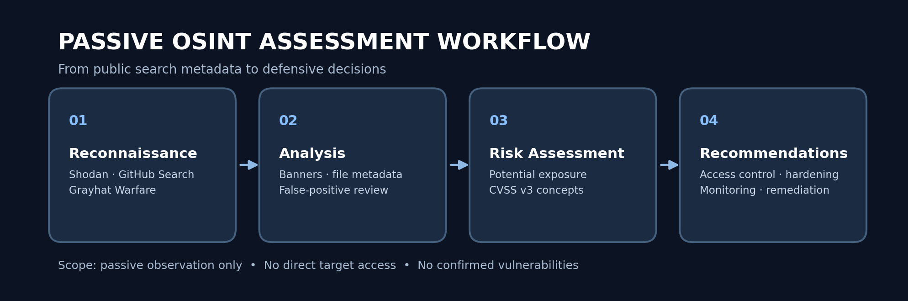
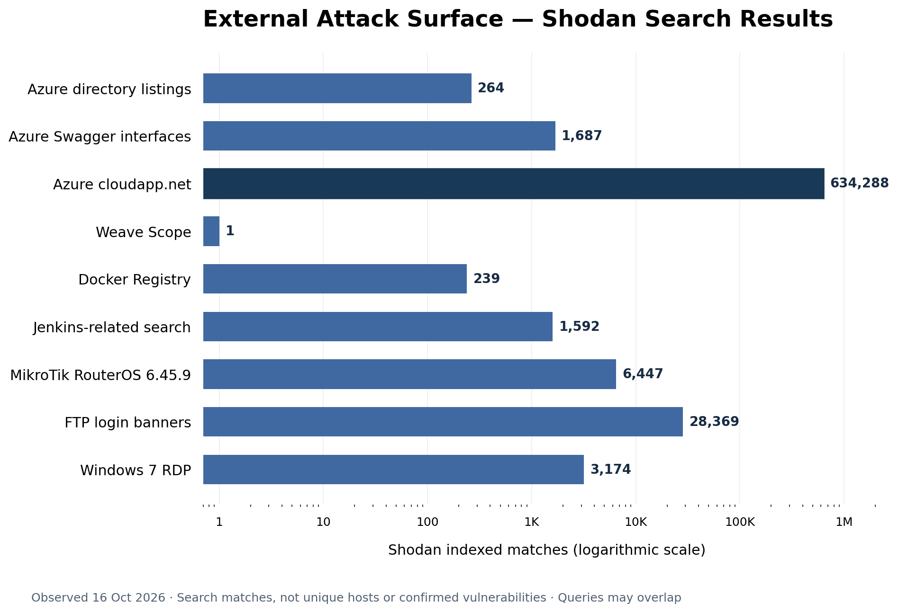

# Cloud Security OSINT Assessment

**Passive Reconnaissance | Cloud Security | Attack Surface Analysis | Risk Assessment**

## Overview

This project presents a cloud security assessment conducted using Open-Source Intelligence (OSINT) techniques to investigate publicly indexed infrastructure and potential security exposure.

Using **Shodan, GitHub Code Search, and Grayhat Warfare**, I analyzed internet-facing services, database technologies, source-code artifacts, and cloud storage metadata.

The objective was to understand how publicly available technical information can reveal potential security weaknesses and support defensive security investigations.

The project emphasizes **evidence-based security analysis**, distinguishing publicly visible information from confirmed vulnerabilities.

## Assessment Workflow

## Reconnaissance Results

The chart summarizes indexed service matches observed during passive reconnaissance on October 16, 2026.

Result counts do not represent confirmed vulnerabilities.

## Objectives

- Identify publicly indexed cloud services and infrastructure.
- Analyze network services, exposed ports, and technology fingerprints.
- Investigate potential database and administrative interface exposure.
- Examine source-code repositories for sensitive-file indicators.
- Analyze publicly indexed cloud storage metadata.
- Apply CVSS v3 concepts to hypothetical security scenarios.
- Develop defensive security recommendations.

## Tools & Technologies

| Tool / Technology | Purpose |
|---|---|
| **Shodan** | Internet-facing service reconnaissance and fingerprinting |
| **GitHub Code Search** | Repository search and sensitive-file exposure awareness |
| **Grayhat Warfare** | Public cloud storage metadata reconnaissance |
| **CVSS v3** | Preliminary security risk classification |
| **MongoDB / Mongo-Express** | Database and administrative interface exposure analysis |
| **Elasticsearch** | Search and analytics service reconnaissance |
| **AWS / Azure / DigitalOcean** | Cloud environments observed through indexed metadata |

## Assessment Workflow

**Passive Reconnaissance → Metadata Analysis → Potential Risk Identification → Defensive Recommendations → Documentation**

The methodology focused exclusively on publicly indexed information.

No direct access to discovered third-party services, authentication attempts, exploitation, or sensitive data extraction was performed.

## Investigations

The project is organized into five technical assessments.

| Assessment | Description | Documentation |
|---|---|---|
| External Attack Surface Reconnaissance | Shodan-based analysis of cloud services, administrative interfaces, registries, and legacy systems | [View assessment](docs/01-shodan-reconnaissance.md) |
| Database Exposure Assessment | MongoDB, Mongo-Express, and Elasticsearch reconnaissance | [View assessment](docs/02-database-exposure.md) |
| Security Risk Assessment | CVSS v3-based analysis of hypothetical database exposure scenarios | [View assessment](docs/03-risk-assessment.md) |
| Source Code Exposure Analysis | GitHub Code Search investigation of configuration files, authentication artifacts, SQL files, and logs | [View assessment](docs/04-github-dorking.md) |
| Cloud Storage Exposure Assessment | Grayhat Warfare metadata analysis across six keyword categories | [View assessment](docs/05-cloud-storage.md) |

## Key Findings

### 1. External Attack Surface Visibility

Shodan searches identified publicly indexed cloud infrastructure, web applications, Docker Registry API responses, container-monitoring interfaces, network-management services, and remote desktop endpoints.

Technology and version metadata demonstrated how externally visible information can support infrastructure inventory and vulnerability research.

Some searches also produced apparent false positives and honeypot indicators, highlighting the limitations of search-engine-based reconnaissance.

### 2. Database Service Exposure Indicators

Passive searches identified indexed information associated with MongoDB, Mongo-Express, and Elasticsearch.

Observed information included server operational metadata, administration-interface indicators, index metadata, and HTTP authentication challenges.

The results did not establish unauthorized database access.

### 3. Preliminary Risk Classification

CVSS v3 concepts were used to analyze hypothetical scenarios involving internet-facing database services and insufficient access controls.

Attack Vector, Privileges Required, and Confidentiality Impact were considered to describe possible security consequences.

No definitive CVSS base scores were assigned because vulnerability conditions were not independently verified.

### 4. Source Code Exposure Awareness

Repository-scoped GitHub Code Search queries were used to investigate configuration templates, authentication-file references, SQL files, and log files.

An `.env.example` configuration template was identified, demonstrating a safer approach to sharing development configuration without publishing real secrets.

No credential exposure was confirmed.

### 5. Cloud Storage Metadata Analysis

Grayhat Warfare searches investigated objects associated with payments, credentials, passwords, administration, databases, and backups.

Most inspected filenames referred to ordinary application assets, media files, or documents.

The assessment demonstrated that keyword-based discovery alone is insufficient to establish sensitive-data exposure.

## Security Recommendations

Based on the observed exposure patterns and hypothetical risk scenarios, the following defensive practices are recommended:

- Maintain an accurate inventory of internet-facing cloud services.
- Restrict unnecessary public access to management interfaces and database services.
- Enforce strong authentication and least-privilege authorization.
- Secure CI/CD platforms and container registries.
- Protect sensitive credentials using appropriate secrets-management solutions.
- Keep production backups and confidential storage objects private.
- Apply security updates and monitor unsupported software.
- Enable logging, access monitoring, and cloud configuration reviews.
- Validate passive reconnaissance findings through authorized security assessments before assigning confirmed vulnerability severity.

## Skills Demonstrated

**Cloud Security:** Attack-surface visibility, cloud storage security, database exposure awareness.

**OSINT & Reconnaissance:** Search operators, service fingerprinting, banner interpretation, metadata analysis.

**Security Assessment:** Evidence evaluation, false-positive identification, preliminary risk classification.

**DevSecOps:** CI/CD exposure awareness, container registry security, secrets management.

**Security Reporting:** Technical documentation, risk communication, defensive recommendations.

## Scope, Ethics & Limitations

This project is based on passive analysis of publicly indexed information.

No third-party systems were directly accessed for security testing. No credentials were collected or tested, and no database records or storage objects were downloaded.

Raw identifying information and original third-party screenshots are excluded from this repository.

Search results may contain false positives, outdated information, duplicate services, or incomplete technology identification.

**The project does not claim confirmed vulnerabilities, successful exploitation, or unauthorized access.**

## Conclusion

This project demonstrates a practical approach to passive cloud security reconnaissance and preliminary risk analysis.

By combining Shodan, GitHub Code Search, Grayhat Warfare, and CVSS concepts, the investigation explores how publicly indexed information can support attack-surface awareness, security prioritization, and defensive decision-making.

The primary outcome is an evidence-based assessment of potential exposure patterns, supported by technical observations, documented limitations, and security recommendations.
